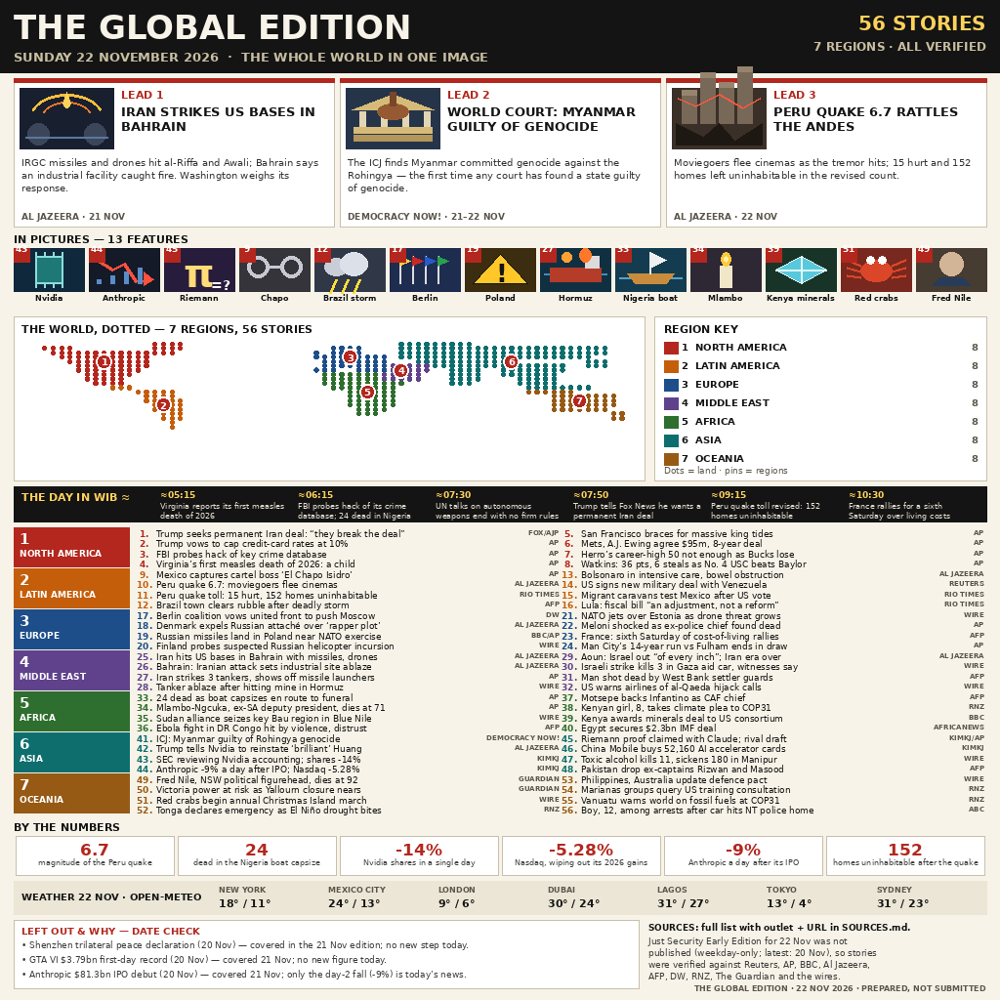

# The Global Edition — 22 November 2026

[](https://make.fun/bounty/news-image-20261122?utm_source=github&utm_medium=readme&utm_campaign=news-image-20261122)
[](https://make.fun/bounty/news-image-20261122/leaderboard?utm_source=github&utm_medium=readme&utm_campaign=news-image-20261122)
[](https://make.fun/bounty/news-image-20261122?utm_source=github&utm_medium=readme&utm_campaign=news-image-20261122)

**Sunday 22 November 2026 — the whole world in one image.**



## What it is

One 1024×1024 poster summing up 22 November 2026's world news:

- **56 numbered stories across 7 regions** (8 per region: North America,
  Latin America, Europe, Middle East, Africa, Asia, Oceania), each with
  its outlet cited on the poster.
- **3 lead stories:** Iran strikes US bases in Bahrain; the World Court
  finds Myanmar guilty of Rohingya genocide; a 6.7 quake rattles Peru.
- **16 illustrated panels** (3 leads + 13 feature tiles) drawn from the
  day's stories.
- **Dot-matrix world map** with 7 numbered region pins + region key.
- **UTC timeline** (6 timed events, WIB), **by-the-numbers** strip (6 stats),
  **weather strip** (day highs/lows for 7 cities, Open-Meteo forecast)
  and a **"left out & why"** date-check box.

Every story was published or reported in the 22 November 2026 news
cycle; full verification URLs are in [SOURCES.md](SOURCES.md). The Just
Security Early Edition for 22 Nov was not published at build time
(weekday-only; latest available edition was 20 Nov), so stories were
verified against Reuters, AP, BBC, Al Jazeera, AFP, DW, RNZ,
The Guardian and the wires listed in SOURCES.md.

## Regenerate

```sh
python3 main.py   # writes entry.png (1024x1024, deterministic)
```
